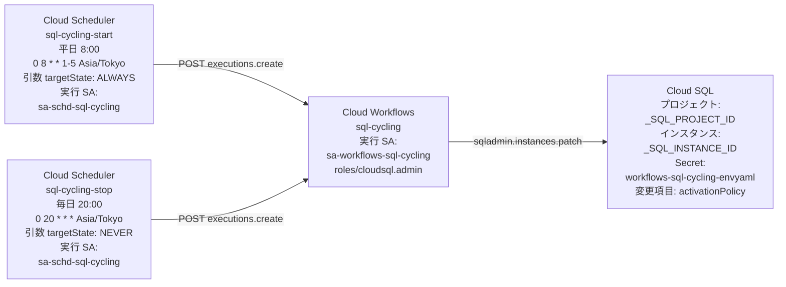

# Cloud SQL を定期起動・停止するサンプル

## 注意点

:warning: 作成途中です :warning:

## 構成図



### Cloud Scheduler の定期実行

- 平日の 08:00 に「起動」の処理
- 毎日 20:00 に「停止」の処理

### Cloud Workflows の flow の処理

1. 現状確認
2. すでに指定状態なら正常終了 (冪等性)
3. 状態変更 API 発行
4. 完了までポーリング待機
5. 失敗時は Slack 通知

## 手順

- 環境変数

```
export _sql_gc_pj_id='Your Cloud SQL Instance of Google Cloud ID'
export _workflow_gc_pj_id='Your Cloud Workflow of Google Cloud ID'
export _scheduler_gc_pj_id='Your Cloud Scheduler of Google Cloud ID'
```

- 以下の略を使用します

```
sql-periodically-starting-and-stopping ===> sql-cycling
```

```
### Cloud Workflow
export _workflow_sa_name="sa-workflow-sql-cycling"
export _workflow_sa_email="${_workflow_sa_name}@${_workflow_gc_pj_id}.iam.gserviceaccount.com"

### Cloud Scheduler
export _scheduler_sa_name="sa-schd-sql-cycling"
export _scheduler_sa_email="${_scheduler_sa_name}@${_scheduler_gc_pj_id}.iam.gserviceaccount.com"
```

- API の有効化

```
gcloud services enable workflows.googleapis.com \
  cloudscheduler.googleapis.com \
  sqladmin.googleapis.com \
  --project ${_workflow_gc_pj_id}
```

### Service Account を作成

- Workflows 用 SA の作成

```
gcloud iam service-accounts create ${WORKFLOW_SA_NAME} \
  --display-name="Service Account for Cloud Workflows" \
  --project ${_workflow_gc_pj_id}
```

- Scheduler 用 SA の作成

```
gcloud iam service-accounts create ${SCHEDULER_SA_NAME} \
  --display-name="Service Account for Cloud Scheduler" \
  --project ${_scheduler_gc_pj_id}
```

### Service Account に Role を付与

- Workflow に Cloud SQL 管理者権限を付与（起動・停止・ステータス確認に必要）

```
# Cloud SQL の操作・管理権限
gcloud projects add-iam-policy-binding ${_workflow_gc_pj_id} \
  --member="serviceAccount:${WORKFLOW_SA_EMAIL}" \
  --role="roles/cloudsql.admin"

# 実行ログ出力権限
gcloud projects add-iam-policy-binding ${_workflow_gc_pj_id} \
  --member="serviceAccount:${WORKFLOW_SA_EMAIL}" \
  --role="roles/logging.logWriter"
```

- Scheduler 用 SA への権限付与

```
# Workflows の実行を呼び出す権限のみを付与
gcloud projects add-iam-policy-binding ${_workflow_gc_pj_id} \
  --member="serviceAccount:${_scheduler_sa_email}" \
  --role="roles/workflows.invoker"
```

### Workflows のデプロイ

```
gcloud workflows deploy sql-periodically-starting-and-stopping \
  --source=workflow.yaml \
  --location=asia-northeast1 \
  --service-account=${_workflow_sa_email} \
  --project ${_workflow_gc_pj_id}
```

### Cloud Scheduler ジョブの作成


- 起動ジョブ（月曜~金曜 08:00）

```
gcloud scheduler jobs create http start-cloudsql-job \
  --schedule="0 8 * * 1-5" \
  --time-zone="Asia/Tokyo" \
  --location="asia-northeast1" \
  --uri="https://workflowexecutions.googleapis.com/v1/projects/${_workflow_gc_pj_id}/locations/asia-northeast1/workflows/sql-periodically-starting-and-stopping:execute" \
  --message-body="{\"argument\": \"{\\\"targetState\\\": \\\"ALWAYS\\\"}\"}" \
  --oauth-service-account-email=${_scheduler_sa_email}
```

- 停止ジョブ（毎日 20:00）

```
gcloud scheduler jobs create http stop-cloudsql-job \
  --schedule="0 20 * * *" \
  --time-zone="Asia/Tokyo" \
  --location="asia-northeast1" \
  --uri="https://workflowexecutions.googleapis.com/v1/projects/${_workflow_gc_pj_id}/locations/asia-northeast1/workflows/sql-periodically-starting-and-stopping:execute" \
  --message-body="{\"argument\": \"{\\\"targetState\\\": \\\"NEVER\\\"}\"}" \
  --oauth-service-account-email=${_scheduler_sa_email}
```
